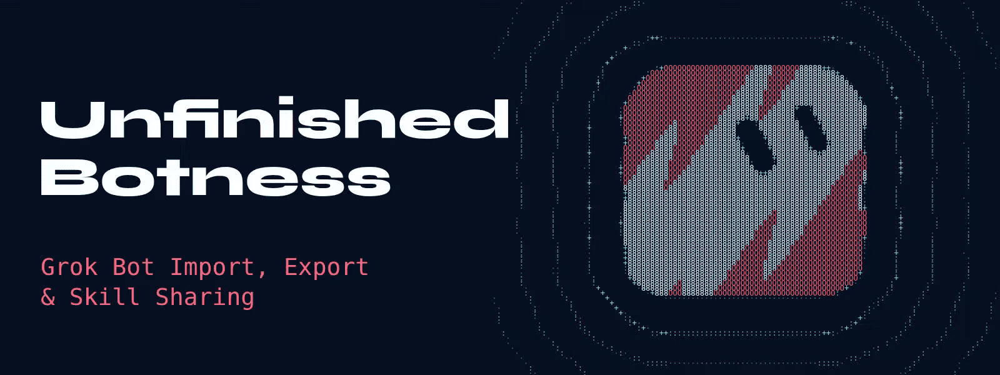
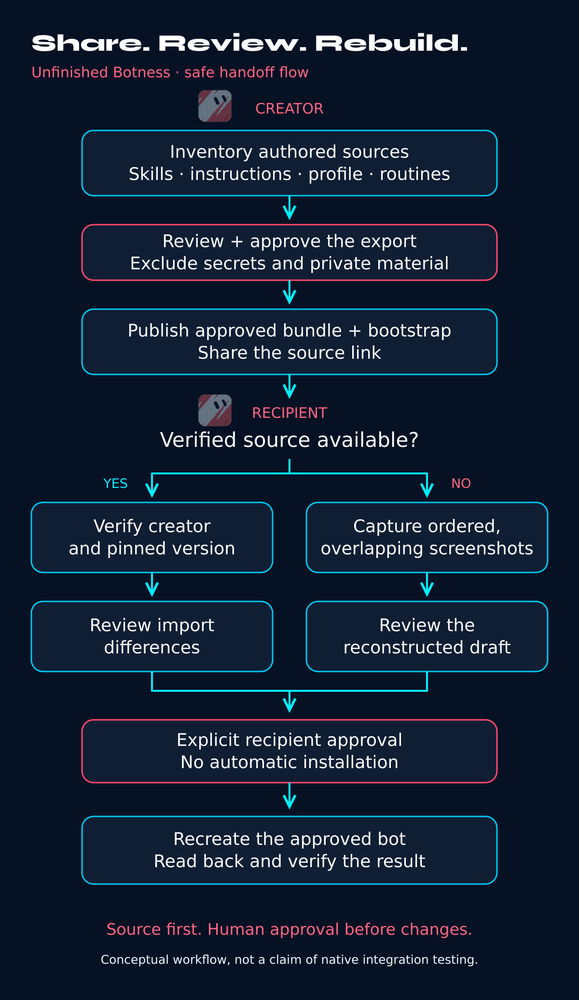
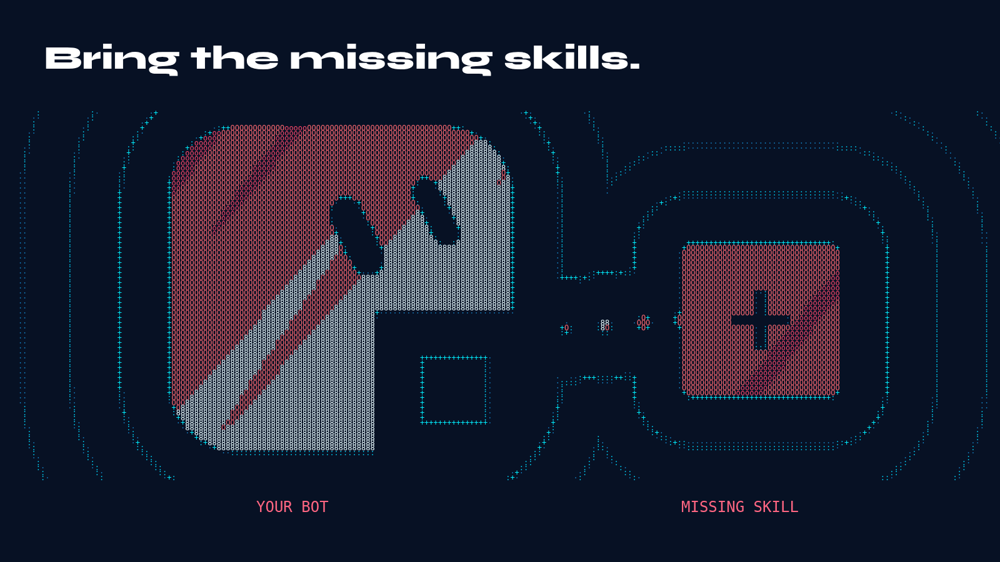
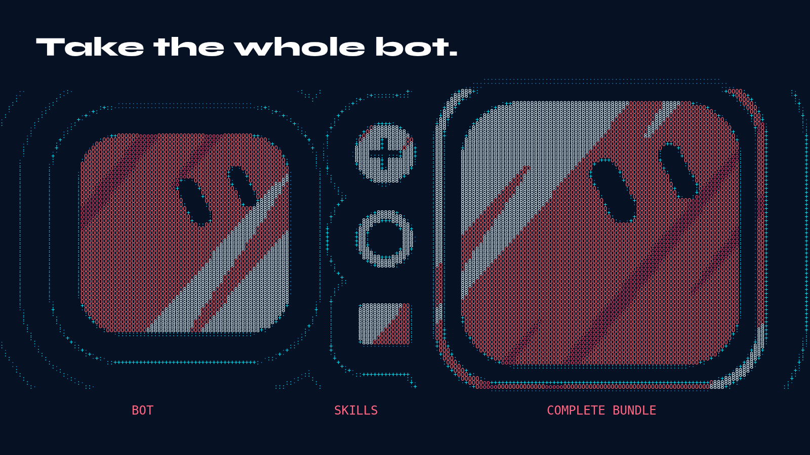
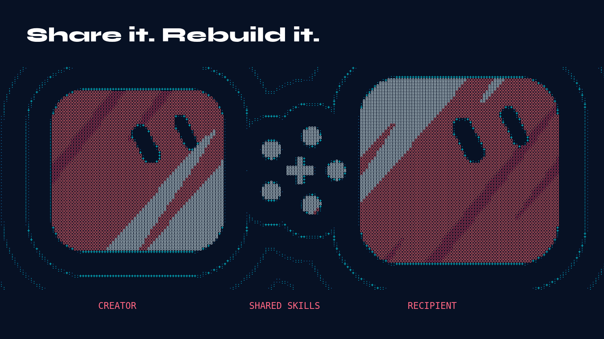

# Unfinished Botness

<picture>
  <source media="(prefers-reduced-motion: reduce)" srcset="assets/signal-assembly/banner-static.png">
  
</picture>

[Static banner](assets/signal-assembly/banner-static.png) · [Share images and artwork source](assets/signal-assembly/README.md)

## Grok Bot Import, Export & Skill Sharing

**Patch Cassidy** is the helper Bot; **Unfinished Botness** is the source kit. Patch helps creators export readable bot source, audit imported bots through direct skill exports, verify creator-owned bundles and review source repairs. Use Grok's existing native export when available, with readable-source backup and explicit omissions where useful. Recovery depends on readable source and review; native export-to-recipient delivery and full-profile round-trip fidelity remain untested by this project.


<p align="center"><code>EXPERIMENTAL</code> · <code>ZERO DEPENDENCIES</code> · <code>NO ACCOUNT WRITES</code></p>


**Independent, unofficial project.** No affiliation with Grok, xAI or Cursor.

**Create Patch Cassidy from this kit:** the chosen helper name/persona is in the original bot instructions and independent launcher for every recipient, alongside six authored skill recipes, routine policy and canonical-source record. Offline tools validate source and prepare review plans. One account reported an earlier helper installation with full character readback; that report does not establish this revision's native export/import round trip, screenshot fidelity, paused-state readback or native updates. Verify the repository and declared files at a reviewed immutable install commit.

[Create the bot](bot/INSTRUCTIONS.md) · [Direct-paste start](GETTING_STARTED.md) · [Product plan](docs/PLAN.md) · [Bundle and workflow formats](docs/BUNDLE_FORMAT.md) · [Evidence](docs/TESTED_STATUS.md)

## Create Patch Cassidy from this repo

1. Start from the exact canonical URL recorded in [SELF_REFERENCE.json](bot/SELF_REFERENCE.json). Verify that repository is actually published, then resolve the reviewed release or installation URL to an immutable commit. Record the full reviewed commit from the installation URL; do not infer or invent a commit ID.
2. Create a fresh Grok Bot and paste the complete [bot instructions](bot/INSTRUCTIONS.md), or use the independent [Getting started launcher](GETTING_STARTED.md) with that reviewed commit URL. The launcher remains available even if Marketplace import or skill installation fails.
3. Have the Bot read its [manifest](bot/manifest.json), the six named source recipes and [routine policy](bot/ROUTINE_POLICY.md) as data. Review an account-wide inventory and exact proposed changes before separately authorizing any native skill creation. No scheduling, permission expansion or app connection follows from setup.
4. Keep the exact installed commit, source hashes, native IDs and local customizations in private user-approved storage. A short optional pointer may reference that record, but memory is not the only bootstrap. The original recipes may be shared under this kit's license; third-party rescued bodies need their own rights review.

New helper skills use `Patch Cassidy / ...` display names. Existing `template-rescue/*` IDs remain stable; the manifest preserves previous names in `legacyNames`. Preview checks IDs and both name forms before proposing creation. Existing-name or content migration requires separate approval.

The pasted workflow works with a Grok Bot account and readable source files. Native tools vary; when fetching or creation is unsupported, use clearly labelled manual-copy source. Optional local CLI tools additionally require an existing Node.js 22+ installation.

The earlier source-recovery flow below illustrates creator export and recipient review. Imported-bot audits now start with direct export from the imported bot; screenshots are the last resort after export fails or is refused.

<p align="center">
  <a href="assets/article/grok-bot-safe-handoff-flowchart.png">
    
  </a>
</p>

*Conceptual workflow; native integration and full round trips remain untested. [Open the full-resolution flowchart](assets/article/grok-bot-safe-handoff-flowchart.png) · [Editable SVG](assets/article/grok-bot-safe-handoff-flowchart.svg).*

## How do I recover missing Grok Bot skills?

Click **Add Bot**, then tell Patch Cassidy the imported bot's name once. Patch gets the inventory directly from that bot, shows the exact export/report file list for your approval, and sends one export request covering all approved skills. The imported bot writes each name, description and complete body to `/workspace/<bot>-skills/<skill-name>.md` and reports byte counts. Patch reads and hashes those files itself, compares any names/descriptions you pasted, and reads every body for references to absent skills.



You receive the file set, a per-skill PASS/FAIL/UNVERIFIED list, a **referenced but not installed** report, and one short summary. Patch handles bot-to-bot messages. You approve file writes and any separately reviewed repair. [Audit recipe](bot/skills/audit-imported-bot.md) · [File format and checker](docs/IMPORTED_BOT_AUDIT.md).

| Finding | Next step |
|---|---|
| Exported skill and matching metadata | Record bytes, hashes and comparison evidence |
| Installed skill with an unreadable body or partial inventory | Report the specific verification gap; ask the bot directly |
| Missing skill with real original full text | Show exact skills/text/destinations and obtain approval before recreating |
| Referenced skill absent with no source | Include quoted references in a short bug-report summary for the author or support |
| Bot cannot or will not export and original source is unavailable | Request only missing screenshots as a last resort |

The helper cannot read a template before import or see another bot's skills through its own catalog. Public share metadata and a short agent-folder description cannot establish skill contents. Instructions, memories and routines remain unverified unless separately approved and exported too. Hashes identify saved bytes; original-template equality requires original evidence. Keep third-party exports private and review rights separately before redistribution.

Screenshots require ordered overlapping images with complete visible text, exact transcription review and explicit gaps. Patch never invents missing skill text. The user-reported direct messaging/export method motivates this flow; this repository's native end-to-end trial remains open.

## How do I export and back up a Grok Bot template?

Guide the creator through selected-Bot inventory first; no native IDs are required in advance. The [creator-export skill](bot/skills/export-creator-bot.md) and [export workflow](EXPORT.md) preserve full readable authored profile instructions, associated skill names/descriptions/bodies and enablement, disabled routine source plus review-only timing/settings, connector names and approved configuration. Report every unreadable/omitted field. Private learned memory, chats, native-ID mappings and unrelated account skills stay outside public source.



*Take the whole bot: inventory the readable authored source and record omissions before sharing.*

Use the [fictional creator-bundle layout](examples/creator/manifest.json), then prepare [recipient bootstrap text](RECIPIENT_BOOTSTRAP.md) for the creator's actual shared Bot and pinned creator-owned source. This is separate from the helper's own Getting started launcher. Associate source with the original template through creator-controlled evidence; keep a full independent bootstrap beside the share URL, even if an optional setup/memory field fails to transfer. A share URL alone is not a complete export. Review publication rights, exact files and destination before saving, then read back bytes/hashes. Native export and full-profile restoration remain untested.



*Share it. Rebuild it: the recipient reviews verified, pinned source and the bootstrap before approving changes.*

## Use native Grok export where available

A first-party tool-catalog report described `CreateBotShareJson` and Grok's managed `export-bot-template` procedure. They were already mentioned earlier in the same session; this is not evidence of a new release. Patch Cassidy checks actual current availability and offers native draft export with explicit permission. The reported path packs installed skills as prose, transforms routine timing into placeholders and excludes custom connectors. Keep exact readable source and an omissions report when those transformations matter. A staged draft is not proof that a recipient received the skills. [Native capability boundaries](docs/NATIVE_EXPORT.md).

## Review exact changes

Keep original authoring, owned export, provided-bundle import and third-party source acquisition distinct. The [export request](EXPORT.md) starts read-only. Private use of a recovered body does not authorize publishing it.

The project-defined manifest keeps stable namespaced IDs, display names, legacy-name aliases, authored one-line descriptions, exact source files, versions, checksums and rights declarations together. It is not a native Grok schema. Imported text is untrusted until reviewed. Inspect a complete account-wide library and the current Bot's enablement; disabled private skills must not be duplicated as “missing.”

The preview shows exact files, diffs, collisions and account-wide effects. Identical source is a no-op. Conflicting/unknown assets block or skip by default; there is no overwrite/delete. The CLI has no network client, account adapter or scheduler. Actual native creation requires separate explicit permission and exact readback. Routine definitions are disabled source data; native paused-state verification remains open. Routine Test can execute real work and usage.

## Optional weekly source checks

Patch Cassidy offers a weekly check of its own verified canonical repository, **off by default**. Choose manual checking or customize cadence, day, local time and IANA timezone. Scheduling creation/enablement requires explicit consent; checking consent never authorizes applying updates.

A check reads commit/release metadata, pins a candidate and compares source against the installed baseline and your current customizations. It explains substantive diffs, permissions, tools, routines and conflicts. Local overrides are preserved when upstream is unchanged; simultaneous edits require review. Unchanged results stay quiet. Before each apply, approve the exact plan and preserve a current-source/native-ID backup with narrow rollback scope. Repo updates cannot grant access or enable routines themselves.

If native scheduling is unavailable, use manual checks. This is recipient-side opt-in checking, not push broadcasting or guaranteed delivery to every shared Bot. No routine is created by the kit or by this build.

## Run the offline tools

Use an existing Node.js 22+ installation. No package download or install is required.

```sh
node --test test/*.test.mjs
node src/cli.mjs validate bot
node src/cli.mjs validate examples/demo
node src/cli.mjs preview bot inventory.local.json FULL_REVIEWED_COMMIT_SHA
node src/cli.mjs match-preview request.local.json candidate.local.json reviewed-evidence.local.json
node src/cli.mjs capture-preview names.local.json captures.local.json
node src/cli.mjs update-preview baseline.local.json local-files.local.json candidate-update.local.json
```

The match tool checks the consistency of separately supplied reviewed evidence; it does not authenticate ownership or fetch URLs. Coverage checks consume review records, not image pixels. Update previews compare three source snapshots and always require apply permission. These tools never create account resources. Formats and limitations are in [BUNDLE_FORMAT.md](docs/BUNDLE_FORMAT.md) and [SECURITY.md](SECURITY.md).

## Evidence you can inspect

| Surface | Local evidence | Remaining boundary |
|---|---|---|
| Bundle validation | Path/count/byte limits, exact hashes, descriptions, rights and disabled source routines | Hashes are not trust |
| Source identity | Exact template/creator/version consistency and reviewed-evidence gates | Independent evidence review still required |
| Screenshot fallback | Coverage/overlap/uncertainty records | No automated capture, OCR or exact original-byte claim |
| Import preview | Collisions, disabled assets, no-ops and account-wide effects | Native Grok import/readback untested |
| Update preview | Available/unchanged/conflict cases and preserved overrides | No native scheduler or update apply implemented |

See [tested status](docs/TESTED_STATUS.md) for the local results and native acceptance limits. No hosted CI badge, universal bug claim or proven importer is advertised. This independent project has no vendor affiliation.

## License and contributions

Code, bot instructions, original recipes and documentation: [MIT](LICENSE). The separate synthetic demo declares CC0-1.0. No marketplace body is included. Keep private context, screenshots, chats, credentials and unrelated files out of public contributions. Submit synthetic reproducers with scoped evidence. [Security guidance](SECURITY.md).

Visual assets: [Article artwork index: cover, workflow illustrations, orbit and bloom](assets/article/README.md) · [Signal Assembly: banner, social share variants, source and attribution](assets/signal-assembly/README.md). The bundled play.core renderer is Apache-2.0; Syne font software and its renamed subset are SIL OFL-1.1.
