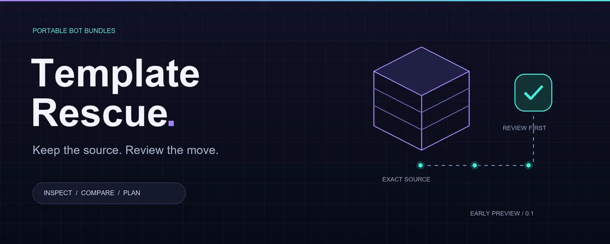

<p align="center"><picture><source media="(prefers-reduced-motion: reduce)" srcset="assets/hero-static.webp"></picture></p>

# Template Rescue: Grok Bot Template Import, Export & Skill Recovery

Template Rescue helps you investigate missing skills after a Grok Bot Marketplace import, verify creator-owned GitHub bundles, reconstruct user-supplied skill screenshots, and export, back up or share reviewed bot templates. Recovery depends on readable source and review; exact restoration and native round-trip fidelity are not guaranteed.

<p align="center"><strong>Find the source. Review the rescue.</strong><br>A bot definition, portable skill bundles and tools for careful template reconstruction.</p>

<p align="center"><code>EXPERIMENTAL</code> · <code>ZERO DEPENDENCIES</code> · <code>NO ACCOUNT WRITES</code></p>

<p align="center"><a href="assets/hero-static.webp">Static artwork</a> · <a href="assets/hero.svg">Vector source</a></p>

**This kit includes Template Rescue itself:** original bot instructions, four authored skill recipes, a routine policy and canonical-source record. It also includes an offline validator and review planners. Native Grok installation, screenshot reconstruction fidelity, paused-state readback and native updates remain untested. Verify the exact canonical repository and all declared files at a reviewed immutable install commit before relying on the bot source.

[Create the bot](bot/INSTRUCTIONS.md) · [Direct-paste start](GETTING_STARTED.md) · [Product plan](docs/PLAN.md) · [Bundle and workflow formats](docs/BUNDLE_FORMAT.md) · [Evidence](docs/TESTED_STATUS.md)

## Build your Template Rescue Bot

1. Start from the exact canonical URL recorded in [SELF_REFERENCE.json](bot/SELF_REFERENCE.json). Verify that repository is actually published, then resolve the reviewed release or installation URL to an immutable commit. Record the full reviewed commit from the installation URL; do not infer or invent a commit ID.
2. Create a fresh Grok Bot and paste the complete [bot instructions](bot/INSTRUCTIONS.md), or use the independent [Getting started launcher](GETTING_STARTED.md) with that reviewed commit URL. The launcher remains available even if Marketplace import or skill installation fails.
3. Have the Bot read its [manifest](bot/manifest.json), the four named source recipes and [routine policy](bot/ROUTINE_POLICY.md) as data. Review an account-wide inventory and exact proposed changes before separately authorizing any native skill creation. No scheduling, permission expansion or app connection follows from setup.
4. Keep the exact installed commit, source hashes, native IDs and local customizations in private user-approved storage. A short optional pointer may reference that record, but memory is not the only bootstrap. The original recipes may be shared under this kit's license; third-party rescued bodies need their own rights review.

The pasted workflow works with a Grok Bot account and readable source files. Native tools vary; when fetching or creation is unsupported, use clearly labelled manual-copy source. Optional local CLI tools additionally require an existing Node.js 22+ installation.

## How do I recover missing Grok Bot skills?

Template Rescue first asks which exact template and creator you mean. It looks for a source repository only when public discovery tools are available.

| Situation | Next step |
|---|---|
| Exact creator-controlled crosslink or original-creator confirmation, plus matching template ID/link/version | Record the evidence URLs and review the pinned bundle |
| Similar name, avatar, star count, lookalike account or self-asserted “official” README | Keep the match unverified |
| No verified match, inaccessible search or ambiguous identity/version | Ask for ordered overlapping screenshots from the pre-Add Bot import screen |
| Cropped beginning/end, missing names, sequence gaps or illegible text | Ask for the specific missing source; do not guess |

Screenshots should include template/creator metadata, the full skill-name list and each skill's title, description and entire body. Show the beginning and end; repeat visible lines between successive images so overlap can be checked. The Bot labels its transcription as a reconstruction, reconciles names/counts and asks you to review the exact proposed text. This fallback uses images you send and does **not** depend on desktop automation. Automated capture/OCR is not implemented here.

A repository match is not an automatic authenticity guarantee or a redistribution license. Hashes of reconstructed text verify that saved transcription, not equality to an unavailable original. GitHub distributes source that someone has supplied; it cannot retrieve missing text by itself. No hidden/private API inspection, access bypass or ordinary-HTTP scraper is assumed.

Cursor staff acknowledged preview skills failing to arrive and recommended screenshot-based recreation with review on October 9, 2026. That is a dated support report, not this project's native test result. [Support discussion](https://forum.cursor.com/t/grok-bot-templates-preview-shows-skills-but-the-export-ships-skills-skills-are-never-delivered/169911).

## How do I export and back up a Grok Bot template?

Start with the read-only [export request](EXPORT.md) for skills and instructions you own or are authorized to use. Ask the source Bot for its actual read/export capabilities and full content; preserve names, authored descriptions, IDs, versions, byte counts, hashes and provenance in a reviewed bundle. Include routine definitions only as disabled source data. If full readback is unsupported, record the limitation rather than reconstructing source from memory.

Keep private backups separate from public templates. Exclude private notes, learned memory, raw conversations, screenshots and credentials from a public bundle. Private use does not grant redistribution rights for third-party Marketplace skill bodies. The original Template Rescue recipes and synthetic examples in this repository are the only skill source shipped by this kit.

## Review before anything changes

Keep original authoring, owned export, provided-bundle import and third-party source acquisition distinct. The [export request](EXPORT.md) starts read-only. Private use of a recovered body does not authorize publishing it.

The project-defined manifest keeps namespaced IDs/names, authored one-line descriptions, exact source files, versions, checksums and rights declarations together. It is not a native Grok schema. Imported text is untrusted until reviewed. Inspect a complete account-wide library and the current Bot's enablement; disabled private skills must not be duplicated as “missing.”

The preview shows exact files, diffs, collisions and account-wide effects. Identical source is a no-op. Conflicting/unknown assets block or skip by default; there is no overwrite/delete. The CLI has no network client, account adapter or scheduler. Actual native creation requires separate explicit permission and exact readback. Routine definitions are disabled source data; native paused-state verification remains open. Routine Test can execute real work and usage.

## Optional weekly source checks

Template Rescue offers a weekly check of its own verified canonical repository, **off by default**. Choose manual checking or customize cadence, day, local time and IANA timezone. Scheduling creation/enablement requires explicit consent; checking consent never authorizes applying updates.

A check reads commit/release metadata, pins a candidate and compares source against the installed baseline and your current customizations. It explains substantive diffs, permissions, tools, routines and conflicts. Local overrides are preserved when upstream is unchanged; simultaneous edits require review. Unchanged results stay quiet. Before each apply, approve the exact plan and preserve a current-source/native-ID backup with narrow rollback scope. Repo updates cannot grant access or enable routines themselves.

If native scheduling is unavailable, use manual checks. This is recipient-side opt-in checking, not push broadcasting or guaranteed delivery to every shared Bot. No routine is created by the kit or by this build.

## Run the offline tools

Use an existing Node.js 22+ installation. No package download or install is required.

```sh
node --test test/*.test.mjs
node src/cli.mjs validate bot
node src/cli.mjs validate examples/demo
node src/cli.mjs preview bot inventory.local.json FULL_REVIEWED_COMMIT_SHA
node src/cli.mjs match-preview request.local.json candidate.local.json reviewed-evidence.local.json
node src/cli.mjs capture-preview names.local.json captures.local.json
node src/cli.mjs update-preview baseline.local.json local-files.local.json candidate-update.local.json
```

The match tool checks the consistency of separately supplied reviewed evidence; it does not authenticate ownership or fetch URLs. Coverage checks consume review records, not image pixels. Update previews compare three source snapshots and always require apply permission. These tools never create account resources. Formats and limitations are in [BUNDLE_FORMAT.md](docs/BUNDLE_FORMAT.md) and [SECURITY.md](SECURITY.md).

## Evidence you can inspect

| Surface | Local evidence | Remaining boundary |
|---|---|---|
| Bundle validation | Path/count/byte limits, exact hashes, descriptions, rights and disabled source routines | Hashes are not trust |
| Source identity | Exact template/creator/version consistency and reviewed-evidence gates | Independent evidence review still required |
| Screenshot fallback | Coverage/overlap/uncertainty records | No automated capture, OCR or exact original-byte claim |
| Import preview | Collisions, disabled assets, no-ops and account-wide effects | Native Grok import/readback untested |
| Update preview | Available/unchanged/conflict cases and preserved overrides | No native scheduler or update apply implemented |
| Artwork | Original 40-frame WebP with static/vector fallbacks | Static/vector fallbacks provided; playback varies by client |

See [tested status](docs/TESTED_STATUS.md) for the saved development count and host-restricted test. No hosted CI badge, universal bug claim or proven importer is advertised. This independent project has no vendor affiliation.

## License and contributions

Code, bot instructions, original recipes and documentation: [MIT](LICENSE). The separate synthetic demo declares CC0-1.0. No marketplace body is included. Keep private context, screenshots, chats, credentials and unrelated files out of public contributions. Submit synthetic reproducers with scoped evidence. [Security guidance](SECURITY.md).
